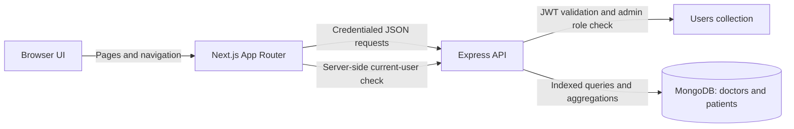
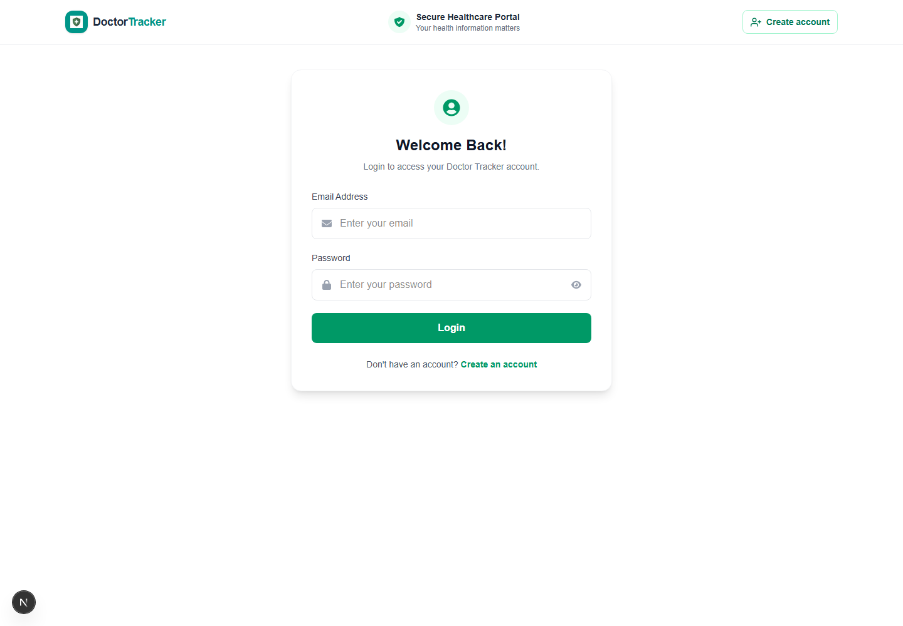
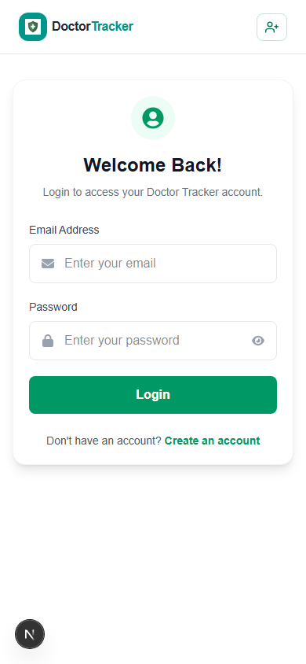

# Doctor Tracker

## Description

Doctor Tracker is an administrator workspace for managing a clinic's doctor and patient records. Administrators can search, filter, and paginate directories, review each doctor's patients, create doctor records, update or remove patients, and view clinic totals and activity trends in a visual dashboard. The Next.js frontend communicates with an Express API, which enforces admin access and stores records in MongoDB.

## Setup Guide

### Prerequisites

- Node.js and npm
- MongoDB Atlas or a local MongoDB server
- A Cloudinary account with an unsigned upload preset for profile photos
- The `doctor-tracker` frontend and `doctor-tracker-backend` folders available as siblings

### 1. Install dependencies

From the frontend directory:

```powershell
npm install
```

Then install the backend dependencies:

```powershell
Set-Location ..\doctor-tracker-backend
npm install
```

### 2. Configure environment variables

In the frontend directory, copy `.env.example` to `.env.local` and fill in the Cloudinary values:

```powershell
Set-Location ..\doctor-tracker
Copy-Item .env.example .env.local
```

| Variable | Purpose | Example |
| --- | --- | --- |
| `NEXT_PUBLIC_API_URL` | Base URL for the Express API | `http://localhost:5000` |
| `NEXT_PUBLIC_CLOUDINARY_CLOUD` | Cloudinary cloud name used for profile photo uploads | `your_cloud_name` |
| `NEXT_PUBLIC_CLOUDINARY_PRESET` | Cloudinary unsigned upload preset | `your_unsigned_preset` |

Create a separate `.env` file in `doctor-tracker-backend`:

```dotenv
PORT=5000
MONGODB_URI=mongodb+srv://<username>:<password>@<cluster-host>/doctor-tracker?retryWrites=true&w=majority
JWT_SECRET=replace-with-a-long-random-secret
```

The backend connects to the `doctor-tracker` database and creates its query indexes when it starts. Keep actual credentials in local environment files or your deployment secret manager; do not commit them.

### 3. Start the backend

In a terminal opened in `doctor-tracker-backend`:

```powershell
npm run dev
```

The API listens on port `5000` by default. The current backend CORS configuration allows the local frontend at `http://localhost:3000`.

### 4. Start the frontend

In a second terminal opened in `doctor-tracker`:

```powershell
npm run dev
```

Open [http://localhost:3000](http://localhost:3000).

### 5. Grant admin access

Registration creates a regular `user` account. To use the admin workspace, register the account first, then promote that account in MongoDB using the exact email address:

```javascript
use doctor-tracker
db.users.updateOne(
  { email: "admin@example.com" },
  { $set: { role: "admin" } }
)
```

Sign in with that account. Role assignment stays server-side; the registration form does not let users grant themselves admin access.

### Useful checks

Run these from the frontend directory:

```powershell
npm run lint
npm run build
```

## System Architecture



- The Next.js App Router renders the dashboard, doctor directory, patient directory, forms, and shared navigation. Client components request list and analytics data from the backend.
- Next.js `proxy.js` redirects requests without a token cookie to sign-in. The server-rendered admin layout asks the backend for the current user and requires the `admin` role before rendering admin pages.
- Express verifies the HttpOnly JWT and database role on every protected API endpoint. It owns validation and all MongoDB reads and writes.
- MongoDB stores `users`, `doctors`, and `patients`. A patient's `doctorId` references a doctor's MongoDB ObjectId. Aggregations provide patient counts per doctor and monthly activity.

## Technical Decisions

### 1. HttpOnly JWT cookie and backend role checks

The login API places the signed JWT in an HttpOnly cookie. Browser JavaScript cannot read that cookie, which avoids exposing the session token to client-side scripts. The Next.js admin layout checks the current user's role to provide the right page experience; the Express API independently validates both the token and admin role for every protected operation. The API remains the authorization boundary.

### 2. MongoDB aggregation and server-side pagination

Search, date filters, counts, and page limits run in MongoDB so the browser receives only the requested page of records. Indexes support user lookups, doctor ordering, patient-to-doctor lookups, and date ordering. Doctor and patient list aggregations apply sorting and pagination before enriching rows with related data, avoiding joins across records outside the requested page. Dashboard totals and monthly counts are also aggregated by MongoDB rather than recomputed from full collections in the browser.

## Visual Evidence

Screenshots show the login UI at desktop (`1440 × 1000`) and mobile (`390 × 844`) viewport sizes.

### Desktop



### Mobile


